# CricVision Pro

An on-device AI cricket biomechanics coach, virtual match simulator and analytics suite, built with Next.js 15, React 19, TypeScript and Tailwind.

Point a phone at the pitch (or press **Start virtual match simulator**) and CricVision Pro will:

1. find the bowler and batter's body joints, track the ball, and hear the bat impact;
2. rebuild the ball's 3D flight with a physics engine and apply MCC Laws (LBW, no-ball, free hit, extras);
3. score the match, draw a live field radar and wagon wheel;
4. give a one-line coaching tip within ~1 s of each ball, and a full report with drills at the end.

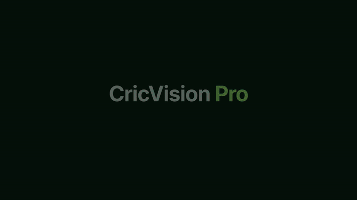

> Full 44 s film: [`docs/video/cricvision-demo.mp4`](docs/video/cricvision-demo.mp4). Its source is in [`docs/video/hyperframes-src`](docs/video/hyperframes-src).

---

## Contents

1. [Quick start](#1-quick-start)
2. [What you see in the app](#2-what-you-see-in-the-app)
3. [Architecture at a glance](#3-architecture-at-a-glance)
4. [Component guide](#4-component-guide)
   - [4.1 Audio impact detector and frame sync](#41-audio-impact-detector-and-frame-sync)
   - [4.2 Computer vision: pose, ball, frame ring](#42-computer-vision-pose-ball-frame-ring)
   - [4.3 Calibration and the world frame](#43-calibration-and-the-world-frame)
   - [4.4 Physics engine](#44-physics-engine)
   - [4.5 Rules engine (MCC)](#45-rules-engine-mcc)
   - [4.6 Live pipeline](#46-live-pipeline)
   - [4.7 Match simulator](#47-match-simulator)
   - [4.8 Biomechanics and analytics](#48-biomechanics-and-analytics)
   - [4.9 AI coach](#49-ai-coach)
   - [4.10 Storage and report](#410-storage-and-report)
5. [Repository map](#5-repository-map)
6. [Configuration](#6-configuration)
7. [Testing](#7-testing)
8. [Known limitations](#8-known-limitations)
9. [Regenerating the figures and video](#9-regenerating-the-figures-and-video)

---

## 1. Quick start

```bash
git clone https://github.com/SaiAbhijyan/CricVision-Pro.git
cd CricVision-Pro
npm install
cp .env.example .env.local     # add GEMINI_API_KEY (optional, see §6)
npm run dev                    # http://localhost:3000
```

| Command | What it does |
|---|---|
| `npm run dev` | development server |
| `npm run build && npm start` | production build and server |
| `npm run typecheck` | `tsc --noEmit` |
| `npm test` | `tsx scripts/selfcheck.ts`: physics, rules, simulator, audio onset, ring buffer, offline report |

**No API key?** Everything still works. The coach falls back to built-in offline rules (the UI shows "Offline rules").

---

## 2. What you see in the app

### Home: configure a session
Choose the format, surface, bowler type, batter skill, field preset and match scenario. The configuration is saved in the browser (`localStorage`, key `cvp-config`) and past sessions are listed below it.

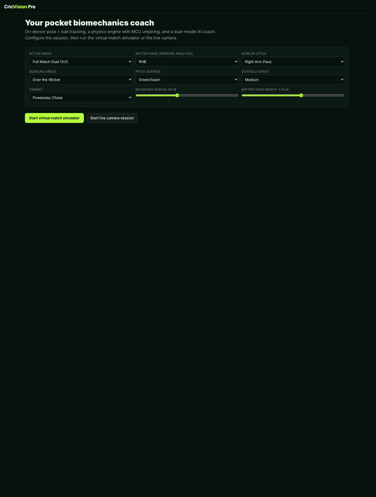

### Session: simulator (or live camera)
Each press of **Bowl next ball** produces a full delivery. The screen has four areas:

| Area | What it shows |
|---|---|
| Scoreboard (top-left) | score, overs, CRR/RRR, last six balls (W = wicket, 4/6, `nb` = no-ball) |
| Live coach | one-line tip, with the source (Gemini or offline rules) and latency |
| Ball card | swing, turn, bounce height, shot, timing quality, exit speed/angle, umpire note |
| Replay | tracer + skeleton at 0.1× to 1×, scrub slider |
| Field radar (right) | draggable fielders, wagon-wheel lines (cyan four, lime six, yellow wicket) |

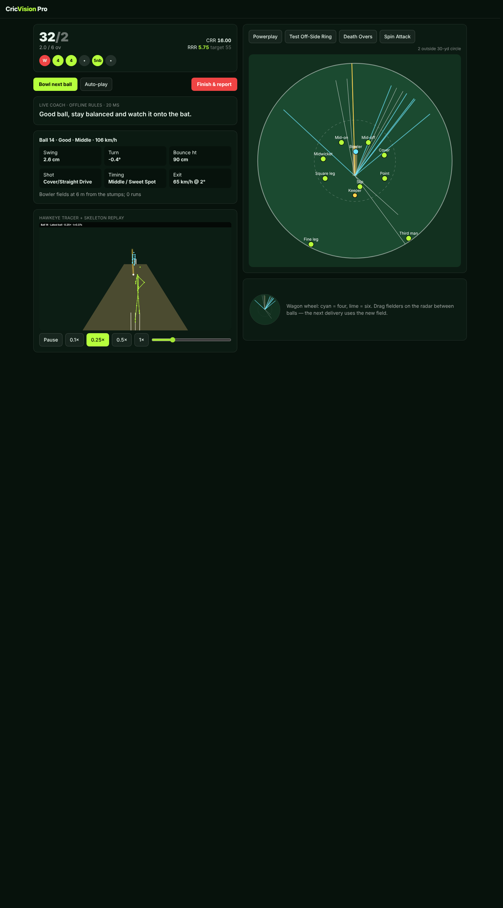

### Report
After **Finish & report** you get an executive debrief (what went right and wrong, with evidence), a 3-drill plan, a slow-motion highlight reel, and the charts explained in [§4.8](#48-biomechanics-and-analytics). JSON export and print/PDF are one click away.

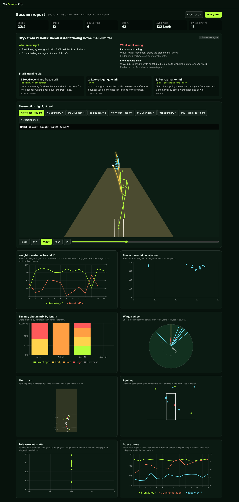

---

## 3. Architecture at a glance

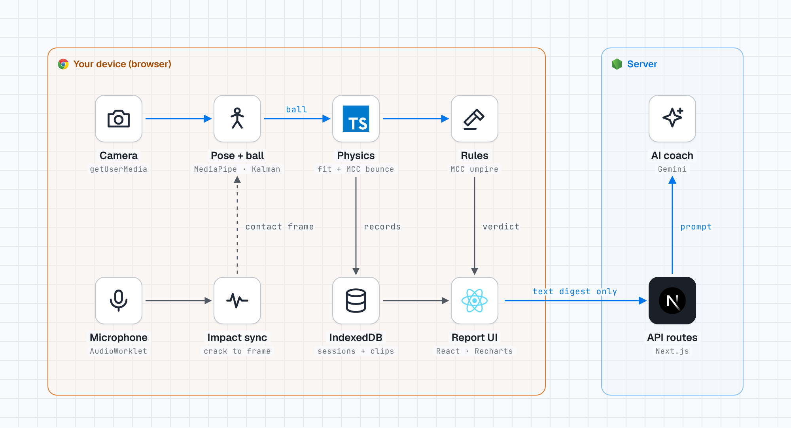

*Tech stack (built with the [stack-diagram skill](https://github.com/caru-ini/stack-diagram); interactive [HTML](docs/figures/stack.html)). Vision, physics and rules run in the browser. Only a short text digest reaches the server, which alone holds the AI key.*


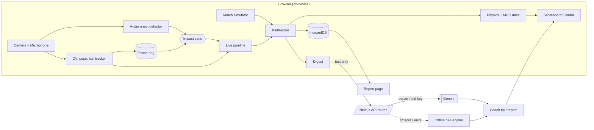

Key design rules:

* **Vision, audio and physics run in the browser.** No video leaves the device.
* **Only a compact text digest** (numbers such as speed, timing, head drift) goes to Gemini, through server routes that keep the API key private.
* **Every coach call has an offline fallback**, so the app never blocks on the network.
* **The simulator and the live camera produce the same `BallRecord`**, so scoring, analytics and reporting are one code path.

---

## 4. Component guide

### 4.1 Audio impact detector and frame sync

*Files: `lib/audio/onset-core.ts`, `lib/audio/transient.ts`, `lib/cv/frame-ring.ts`*

**Problem.** The ball touches the bat in a few hundred microseconds, but a camera only records 30 to 240 frames per second. To show the exact contact frame, we use sound. The crack is a sharp, broadband burst; we find it and then look up the video frame whose timestamp is nearest.

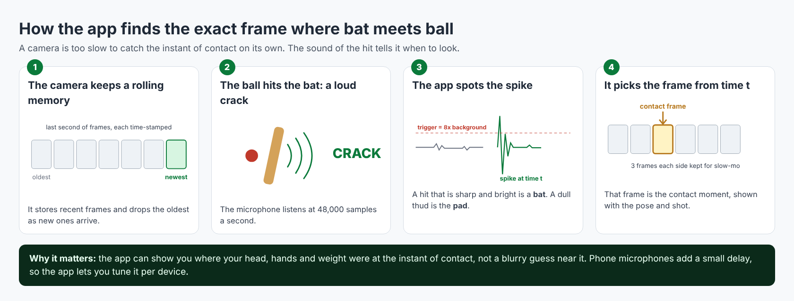

*Fig 1. Four steps: the camera keeps a rolling memory of frames, the bat-ball crack is heard, the app spots the spike, and it picks the frame stamped with that time. Source: [`docs/figures/src/fig1-explainer.html`](docs/figures/src/fig1-explainer.html).*

| Step | Real component | What it does |
|---|---|---|
| 1 | `FrameRing<T>` | circular buffer of recent frames; the oldest are evicted and their `ImageBitmap` closed |
| 2 | `AudioWorklet` input | streams audio at 48 kHz |
| 3 | `classify()` in `onset-core.ts` | fires when band energy is 8x the running noise floor, then labels the hit **bat-sweet**, **bat-edge** or **pad-body** from a 20 ms window |
| 4 | `nearest(t)` | returns the frame whose timestamp is closest to the spike; 3 frames either side are kept for the slow-motion clip |

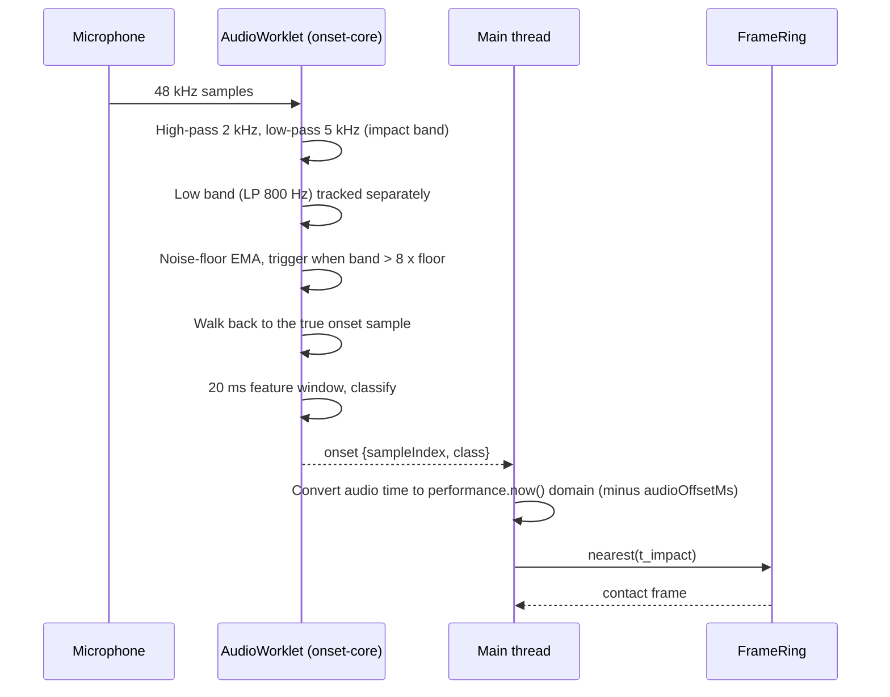

How it works, in plain terms:

* **Why 2 to 5 kHz?** Bat-on-ball clicks are bright; crowd, wind and speech mostly sit lower. Filtering to this band boosts the click against the background.
* **Why walk back?** A threshold crossing happens slightly *after* the true start of the sound. The detector walks backwards to where the signal first rises, so the timestamp is the onset, not the peak.
* **Why classify?** A sweet-spot hit is loud in the high band and short; an edge is quieter and duller; a pad or body hit has more low-band energy and no sharp click. This feeds the umpire (LBW vs bat) and the coach.
* **Same code in two places.** `ONSET_CORE_SOURCE` is a plain-JavaScript string. It is loaded into an `AudioWorklet` through a Blob URL in the browser, and into Node with `new Function` for tests, so what we test is what runs.
* **Fallback.** Browsers without `AudioWorklet` use an `AnalyserNode` polling loop (about 12 ms precision instead of the worklet's sample-level timing).
* **Clock alignment.** Audio and video use different clocks. We map audio time into the `performance.now()` domain with `getOutputTimestamp` and subtract a configurable `audioOffsetMs` for the device's input latency.

### 4.2 Computer vision: pose, ball, frame ring

*Files: `lib/cv/pose.ts`, `skeleton.ts`, `ball-detector.ts`, `kalman.ts`, `biomech.ts`, `frame-ring.ts`*

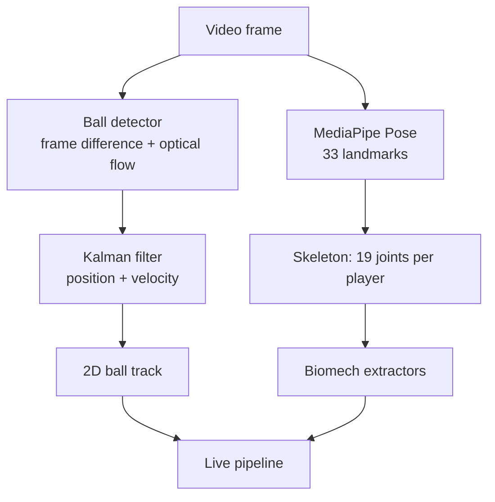

* **Pose.** MediaPipe Pose Landmarker (`@mediapipe/tasks-vision`) runs on-device. Landmarks are normalised (0 to 1) image coordinates; the world-frame lift is in §4.3. The WASM runtime and model load from a CDN by default (see [limitations](#8-known-limitations)).
* **Ball.** A small, fast object is hard to detect directly. We look for moving blobs (frame differencing plus optical flow) near the predicted position, and a **Kalman filter** smooths the track and predicts through missed frames.
* **Skeleton.** The 33 landmarks are reduced to 19 joints per player for storage and overlay (layout in `CLIP_LANDMARK_LAYOUT`; `-1` means missing).
* **Frame ring.** `FrameRing<T>` keeps only the last few seconds of frames, so memory stays bounded.

### 4.3 Calibration and the world frame

*Files: `lib/physics/homography.ts`, `components/CalibrationOverlay.tsx`*

Everything is computed in metres in a **world frame**:

* origin: base of the bowler's stumps; +Y towards the batter (batter's stumps at y = 20.12 m, the 22-yard pitch); +X is the batter's right (off side for a right-hander); Z is up.
* Shot azimuth is clockwise from −Y: `direction = (sin az, −cos az)`.
* Left-arm bowlers and left-handed batters are handled by mirroring `x → −x`.

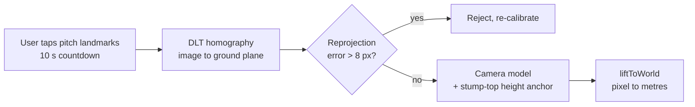

* The **homography** maps image points to the flat pitch. A stump-top anchor adds the vertical scale so heights can be estimated.
* The simulator uses a **virtual camera** (`virtualCamera()`), so replays look like a real camera view.

### 4.4 Physics engine

*Files: `lib/physics/ballistics.ts`, `bat.ts`, `trackfit.ts`, `optim.ts`, `constants.ts`*

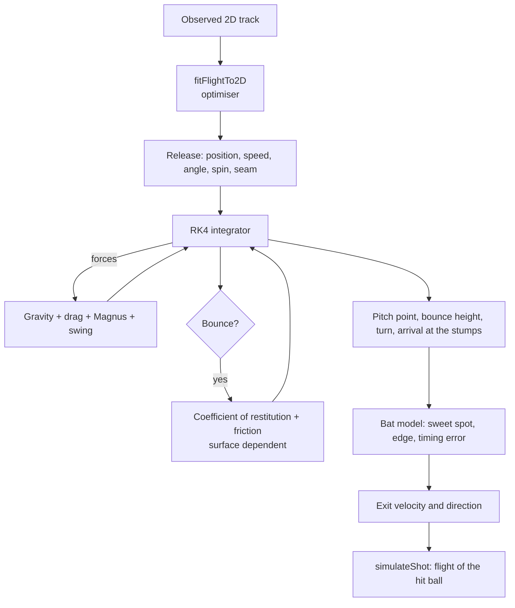

* **Forward model.** A 4th-order Runge-Kutta integrator advances the ball with gravity, air drag, **Magnus** force (spin curving the ball) and **swing** (seam-driven sideways acceleration; strongest on a green pitch).
* **Bounce.** Surface-specific coefficient of restitution and friction decide height and turn.
* **Inverse model (live mode).** `fitFlightTo2D` searches for release parameters whose predicted flight best matches the 2D pixel track, giving speed, line, length and swing from a single camera.
* **Bat.** Sweet-spot hits give high exit speed; timing error (early/late) and edges change exit angle and speed.

### 4.5 Rules engine (MCC)

*Files: `lib/rules/umpire.ts`, `scoreboard.ts`, `field.ts`, `shot.ts`*

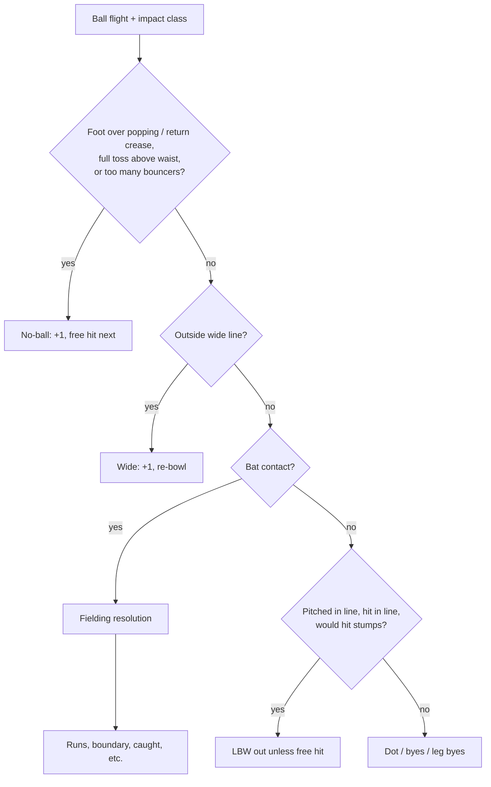

* **Extras, LBW, free hit and no-ball** follow MCC Laws.
* **Field engine.** Fielders have speed, reaction time and a throwing arm. The engine decides whether a hit ball is caught, stopped or reaches the boundary, and awards runs.
* **Presets.** *Powerplay*, *Test Off-Side Ring*, *Death Overs*, *Spin Attack*; fielders can be dragged on the radar between balls.

### 4.6 Live pipeline

*File: `lib/live/pipeline.ts` (`buildLiveBall`), `lib/live/clip.ts`, `components/LiveSession.tsx`*

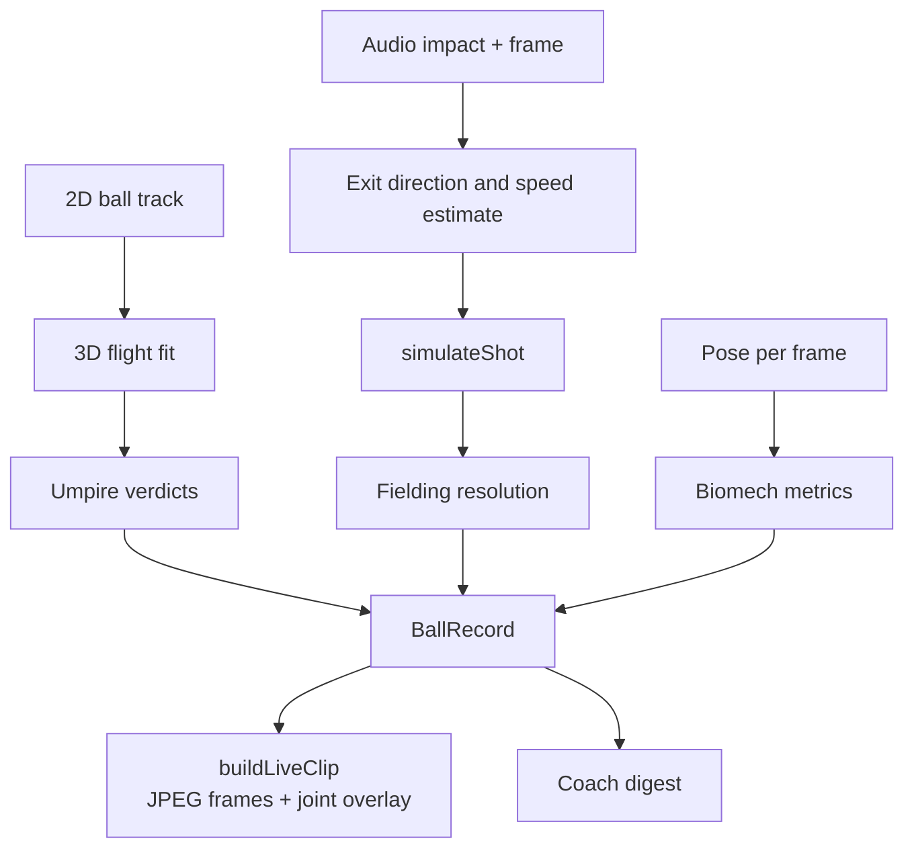

The live path uses **monocular approximations**: the exit azimuth comes from unprojecting the ball's post-impact motion to the ground plane at a fixed 0.8 m height, and the elevation is inferred from apparent speed. These are documented in [limitations](#8-known-limitations).

### 4.7 Match simulator

*Files: `lib/sim/match-sim.ts`, `rng.ts`, `synth-pose.ts`, `virtual-camera.ts`, `clips.ts`*

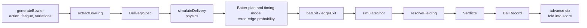

* Seeded (`mulberry32`) so a session is reproducible.
* The bowler aims at a target line that compensates for the release angle, with skill-dependent noise. Swing depends on the surface (Green 2.6, Astro 0.8, other 1.4).
* `advance(ctx)` is shared by the batch and the interactive session, so both score identically.
* Clips are generated for noteworthy balls (wickets, boundaries, head-drift flags) with synthetic poses for the replay.

### 4.8 Biomechanics and analytics

*Files: `lib/cv/biomech.ts`, `lib/analytics/aggregate.ts`, `components/report/Charts.tsx`*

| Chart | Reads as | Why it matters |
|---|---|---|
| Weight transfer vs head drift | front-foot weight % and head drift (cm, + toward off side) | head falling away with weight staying back explains edges |
| Footwork–wrist correlation | stride length vs wrist snap per swing | links footwork to bat speed |
| Timing/shot matrix by length | share of sweet-spot / early / late / edge per length | shows which lengths cause errors |
| Wagon wheel | shot direction from the batter | scoring zones |
| Pitch map | bounce points, bowler at top | line and length consistency |
| Beehive | where balls crossed the stumps | channel discipline |
| Release-slot scatter | release lateral position vs height | a tight cluster means a repeatable action; spread telegraphs variations |
| Stress curve | front-knee angle, counter-rotation, elbow extension per ball | fatigue shows as the knee collapsing while the back twists |

### 4.9 AI coach

*Files: `lib/coach/*`, `app/api/coach/live/route.ts`, `app/api/coach/report/route.ts`*

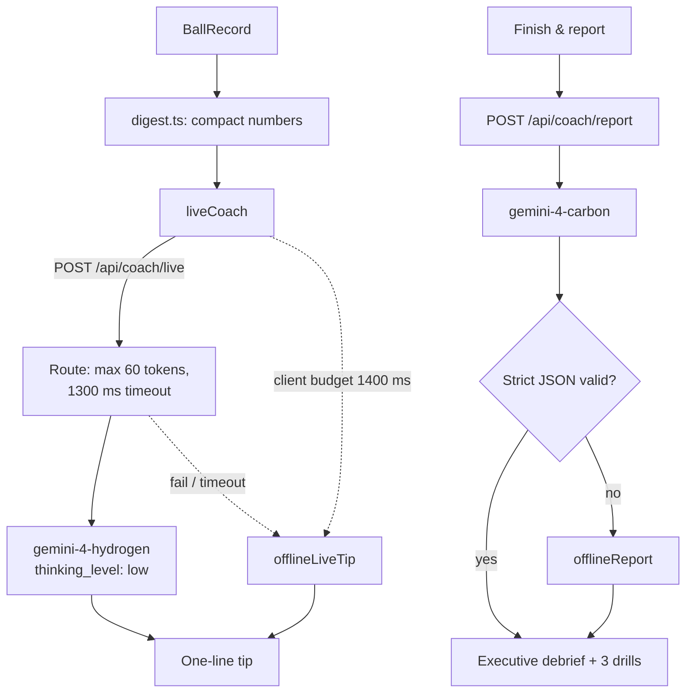

* **Two models.** `gemini-4-hydrogen` (fast, low thinking) for per-ball tips; `gemini-4-carbon` for the end-of-session report. Model IDs are configurable (see §6).
* **Key stays on the server.** The browser calls `/api/coach/*`; the route adds the `x-goog-api-key` header.
* **Latency budget.** The live route is capped at 60 output tokens and 1300 ms; the client gives up at 1400 ms and shows the offline tip, so a slow network never delays the next ball.
* **Strict report schema.** The report response must be valid JSON of the expected shape, otherwise `offlineReport` (deterministic rules over the same digest) produces it.
* **Speech.** `speech.ts` can read tips aloud.

### 4.10 Storage and report

*Files: `lib/storage/idb.ts`, `app/report/[id]/page.tsx`, `components/report/*`*

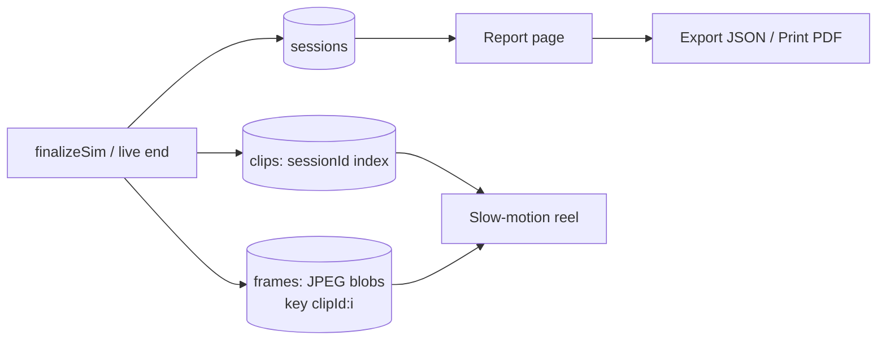

* Everything is stored in the browser's **IndexedDB** (`sessions`, `clips`, `frames`).
* Simulated clips store joint overlays only; live clips also store JPEG frames, which `ReplayCanvas` preloads once and draws synchronously.
* **Tripod / thermal-saver mode** (`TripodMode.tsx`) keeps the screen awake with a wake lock and lowers the processing rate to avoid overheating.

---

### 4.11 Bowling report: swing and turn against a normal delivery

*Files: `lib/physics/ballistics.ts` (`measureMovement`), `components/report/BowlingReport.tsx`*

Each delivery is compared with a **normal ball**: the same release position and velocity flown with no swing and no spin. The difference is what the bowler added.

| Measure | Meaning |
|---|---|
| Swing | sideways drift in the air, in cm, measured at the pitching point (max in flight also shown) |
| Seam movement / turn | extra sideways movement after pitching, in cm and as a direction change in degrees |
| Float / dip | how much fuller or shorter the ball landed than the normal ball |
| Total at stumps | swing plus turn, signed; **away** means toward the batter's off side |

The report draws top-down and side views of the real path against the dashed normal path, with a per-ball table. Pace bowlers' movement is labelled seam movement, spinners' turn.

### 4.12 Bat swing and weight transfer

*Files: `lib/cv/biomech.ts`, `components/report/BatSwing.tsx`*

Per shot: bat speed (estimated from hand speed), attack angle, swing path, downswing time, swing arc, front-foot weight at contact, and head drift. The report plots bat speed against ball exit speed and weight transfer by length.

### 4.13 Player DNA

*Files: `lib/analytics/profile.ts`, `app/profile/page.tsx`*

Built from every session stored on the device. Batting: archetype (withheld below 12 shots), scoring zones, strengths and weaknesses, technique mean and spread, strike rate against pace and spin, and a trend (needs 3 or more sessions). Bowling: stock ball, accuracy in the channel, swing and turn, release spread, fatigue. Confidence rises with the number of shots.

### 4.14 Live ball tracking fit

*Files: `lib/physics/trackfit.ts`, `lib/live/fit.worker.ts`*

An 8-parameter fit (release position, velocity, swing, spin) to the tracked pixels, with a ridge prior, a boundary-value grid search and a two-stage Nelder-Mead, run in a Web Worker (about 3 s per ball). With one camera, swing and spin are partly confounded and magnitudes can be off by up to about 15 cm.

### 4.15 Security

See [SECURITY.md](SECURITY.md): allowlist reconstruction of all client data, same-origin checks, rate limits, size caps, strict headers, and self-hosting of the vision models.

## 5. Repository map

```
app/                 Next.js routes: home, /session, /report/[id], /api/coach/*
app/profile          Player DNA page
components/          UI: Scoreboard, FieldRadar, SetupPanel, SimSession, LiveSession,
                     ReplayCanvas, CalibrationOverlay, TripodMode, report/*
lib/audio/           onset detector (+ AudioWorklet source) and wrapper
lib/cv/              pose, skeleton, ball detector, Kalman, biomech, frame ring
lib/physics/         ballistics, bat, homography, track fit, optimiser, constants
lib/rules/           umpire (MCC), scoreboard, field engine, shot model
lib/sim/             match simulator, virtual camera, synthetic poses, clips
lib/live/            live pipeline + clip builder
lib/coach/           digest, prompts, Gemini client, offline rules, speech
lib/analytics/       aggregation for charts, Player DNA (profile.ts)
lib/security/        sanitizer, rate limit, same-origin checks
lib/storage/         IndexedDB layer
scripts/selfcheck.ts end-to-end self checks (npm test)
docs/                figures, screenshots, video
```

## 6. Configuration

Copy `.env.example` to `.env.local`:

| Variable | Purpose |
|---|---|
| `GEMINI_API_KEY` | server-side key (never exposed to the browser) |
| `GEMINI_LIVE_MODEL` | model for live tips (default `gemini-4-hydrogen`) |
| `GEMINI_REPORT_MODEL` | model for the report (default `gemini-4-carbon`) |
| `GEMINI_API_BASE` | override the API base URL |

Without a key the coach runs in offline mode.

## 7. Testing

`npm test` runs `scripts/selfcheck.ts` and `scripts/checks.ts` (61 assertions: movement vs normal delivery, Player DNA, sanitizer, rate limit). The first covers: physics sanity (bounce, swing), MCC rules, the full simulator, the audio onset detector (synthetic clicks in noise), the frame ring (eviction and nearest lookup), and the offline report. `npm run typecheck` and `npm run build` must also pass.

## 8. Known limitations

* **The live camera path has not been validated on real hardware.** It compiles and its maths is covered by synthetic tests; expect to tune thresholds on a real device.
* **Monocular approximations.** One camera cannot measure depth directly; exit azimuth/elevation and speeds are estimates (see §4.6).
* **Model names.** `gemini-4-hydrogen` and `gemini-4-carbon` follow the project specification; change them in `.env.local` if your account uses different IDs.
* **Network assets.** The MediaPipe WASM and pose model load from a CDN by default; run `npm run vendor:models` and set `NEXT_PUBLIC_SELF_HOST_ONLY=1` to self-host.
* **Swing and spin from one camera** are approximate (see 4.14). Bat speed is an estimate.
* **Security trade-offs** (CSP `unsafe-inline`, in-memory rate limit) are listed in SECURITY.md.
* **Audio.** Input latency differs per device; tune `audioOffsetMs`. The analyser fallback is about 12 ms precise.

## 9. Regenerating the figures and video

* **Fig 1** is plain HTML/SVG in `docs/figures/src/fig1-explainer.html`; screenshot it with headless Chrome. The stack diagram was built with the stack-diagram skill (`docs/figures/stack.html`).
* **Screenshots** in `docs/screens` were captured from the production build with headless Chrome (simulator, 14 balls, then Finish).
* **Video.** The [brag skill](https://github.com/latent-spaces/brag) is built on Hyperframes. The `/brag` skill itself was not available in this environment, so the film was composed directly with the Hyperframes CLI (HTML + GSAP): see [`docs/video/hyperframes-src`](docs/video/hyperframes-src). Render with `npx hyperframes render` from that folder (Node 22+, ffmpeg and Chrome required).
